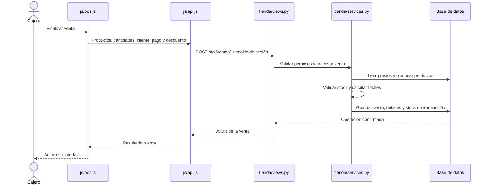

# Entender Papel y Luna — guía de estudio

Esta guía describe el código local de MVP 3. No certifica el despliegue de Render.

## 1. Qué cambió desde MVP 2

Antes, JavaScript hablaba con Apps Script y Google Sheets. Ahora habla con una API REST de Django y una base relacional. El frontend sigue siendo HTML/CSS/JavaScript vanilla.

La diferencia principal no son las pantallas: **el servidor ahora decide los importes válidos, permisos y movimientos de inventario**. Cambiar un número en la consola del navegador no debería cambiar las reglas del negocio.

## 2. Para qué sirve cada tecnología

| Pieza | Trabajo en este proyecto |
|---|---|
| HTML | Define vistas, formularios y botones. |
| CSS | Presentación, responsive, skeletons y estados visuales. |
| JavaScript | Carrito, interacción, renderizado y peticiones. |
| Django | Aplicación del servidor, usuarios, sesiones, ORM y transacciones. |
| Django REST Framework | Vistas HTTP, permisos, serialización y respuestas JSON. |
| SQLite / PostgreSQL | Persistencia real. `settings.py` elige por `DATABASE_URL`; no por el nombre del equipo. |
| psycopg | Conector Python para PostgreSQL. |
| Gunicorn | Servidor de producción que carga `config.wsgi.application`. No contiene las reglas del POS; no demuestra por sí solo que Render esté activo. |
| WhiteNoise | Middleware para archivos estáticos. Además, `config/urls.py` tiene rutas explícitas para los recursos del frontend. |
| Render | Plataforma de alojamiento prevista en la configuración; su estado real requiere comprobar el despliegue. |

## 3. Los archivos que debes estudiar primero

| Archivo | Pregunta que responde |
|---|---|
| `backend/config/urls.py` | ¿Cómo llega `/api/` a las rutas de la tienda? ¿Cómo se sirve `index.html`? |
| `backend/tienda/urls.py` | ¿Qué URL y acción corresponden a cada operación? |
| `backend/tienda/views.py` | ¿Quién recibe la petición y qué permiso exige? |
| `backend/tienda/permissions.py` | ¿Qué puede hacer cada rol? |
| `backend/tienda/serializers.py` | ¿Cómo pasan los campos del modelo a JSON y cómo se validan los CRUD? |
| `backend/tienda/services.py` | ¿Dónde se calculan ventas, correcciones, reembolsos y compras? |
| `backend/tienda/models.py` | ¿Qué tablas y relaciones existen? |
| `js/api.js` | ¿Cómo se envían peticiones y cookies y cómo se convierten errores en excepciones? |
| `js/pos.js` | ¿Dónde están el carrito, los totales de vista previa y el cierre/corrección? |
| `js/app.js` | ¿Cómo se conectan eventos, sesión, navegación, faltantes y reportes? |

El resto del frontend:

- `productos.js`: CRUD y modal reutilizado desde Productos, POS y Compras.
- `clientes.js`: listado, guardado y modal compartido; creación contextual desde POS.
- `gestion.js`: categorías/proveedores, protección de relaciones y proveedor contextual.
- `compras.js`: líneas, registro de compra y detalle. El servidor realiza el movimiento de inventario.
- `historial.js`: ventas abiertas/cerradas, detalle, corrección, reembolso e impresión.
- `ventas-abiertas.js`: guardar, retomar y cerrar usando el mismo identificador.
- `borrador-venta.js`: estado local de interfaz, separado por usuario. No almacena un catálogo ni ventas oficiales.
- `loading.js`: contador de peticiones concurrentes y skeletons.
- `ui.js`: confirmaciones, formularios en modales, foco, Escape y escape de texto que se inserta como HTML.

## 4. Cuatro flujos que debes poder explicar

### Crear una venta

1. El carrito `factura` está en memoria del navegador.
2. El POS prepara los IDs, cantidades y datos de pago.
3. `apiPost("ventas", "create", datos)` se traduce a un POST REST.
4. Django identifica al usuario mediante su sesión y comprueba permisos.
5. `guardar_o_cerrar_venta()` lee los productos de la base; utiliza sus precios oficiales.
6. Si es cerrada, valida y descuenta stock. Si es abierta, no descuenta.
7. La venta y sus líneas se guardan dentro de `transaction.atomic`.
8. El frontend recibe JSON, limpia el carrito y actualiza catálogo/historial.

Una transacción hace que, si falla una escritura de la operación, se reviertan las anteriores. `select_for_update()` bloquea los productos durante la transacción en una base que lo soporte, como PostgreSQL. SQLite no permite probar esa misma concurrencia por filas.

### Corregir una venta

El administrador consulta una venta cerrada y la lleva al POS. Al guardar se llama a `/api/ventas/<id>/corregir/`, conservando ese ID. Si antes vendió 3 unidades y ahora vende 5, el servidor descuenta la diferencia de 2, no otras 5. Si reduce a 1, devuelve 2.

La venta conserva marca, usuario y fecha de corrección. El código actual impide corregir ventas con reembolsos: el botón explica esa restricción. Una venta corregida sin reembolsos sí puede corregirse otra vez.

### Aplicar un descuento

Solo se aplica uno por venta y se calcula sobre subtotal + IVA. Un fijo superior al total produce total cero. El backend guarda nombre, tipo, valor y monto aplicados como datos históricos; borrar el descuento del catálogo no cambia la factura pasada.

El descuento puntual usa esos mismos campos sin crear un registro en el catálogo. Definir uno nuevo exige administrador; el cajero puede aplicar descuentos existentes y cerrar una abierta que ya tenga un descuento autorizado, conservando su valor.

### Registrar una compra

La compra envía proveedor y varias líneas con producto, cantidad y costo. El backend guarda compra y detalles, suma stock a los productos controlados y actualiza costos en una transacción. Los productos sin seguimiento reciben el costo nuevo, pero no un incremento de stock.

## 5. Permisos: la interfaz y el servidor

Ocultar un botón facilita el uso; **no es una medida de autorización suficiente**. El servidor también debe rechazar peticiones prohibidas.

Según P3.1, sección 3.8, el cajero sí puede editar nombre, categoría, precio y costo desde el POS. No puede crear/eliminar productos ni alterar código o inventario. El administrador conserva el CRUD completo. Clientes y faltantes están disponibles para ambos roles; la administración de compras, proveedores, descuentos, correcciones, reembolsos y reportes está restringida.

## 6. Cómo estudiar sin memorizar

1. Abre `tienda/urls.py` y encuentra la ruta de una venta.
2. Sigue la clase correspondiente en `views.py` hasta su llamada a `services.py`.
3. Localiza dónde se calcula el total y dónde cambia el stock.
4. Busca el modelo `Venta` y su tabla `DetalleVenta`: explica por qué son tablas separadas.
5. Vuelve al frontend y encuentra el botón y su evento en `pos.js`.
6. Con DevTools → Network, observa un POST de prueba: URL, cuerpo, respuesta y estado HTTP. No compartas cookies ni contraseñas.
7. Ejecuta una prueba cambiando la cantidad y predice el stock antes de ver el resultado.

Preguntas útiles para practicar:

- ¿Por qué no confiamos en `total` enviado por JavaScript?
- ¿Qué diferencia hay entre abrir un modal y guardar en la base?
- ¿Qué pasa si falla la validación a mitad de una corrección?
- ¿Por qué una factura conserva el nombre/precio histórico del producto?
- ¿Por qué un error al cerrar sesión no debe mostrarte como desconectado si el servidor sigue autenticado?

## 7. Qué falta verificar fuera del entorno local

No se consultó una URL real de Render ni se modificó su base. Deben verificarse el despliegue, variables de entorno, usuarios, cookies/HTTPS y concurrencia en PostgreSQL. La autenticación actual exime CSRF; es una limitación preexistente que merece revisión antes de usar datos reales. No se añadieron OAuth, roles nuevos ni cambios de modelos en esta iteración.
